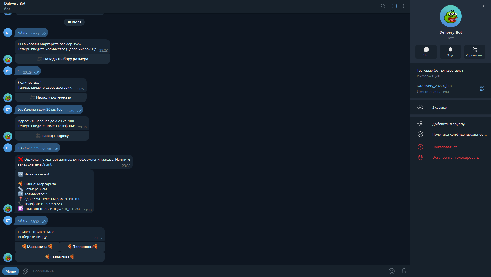
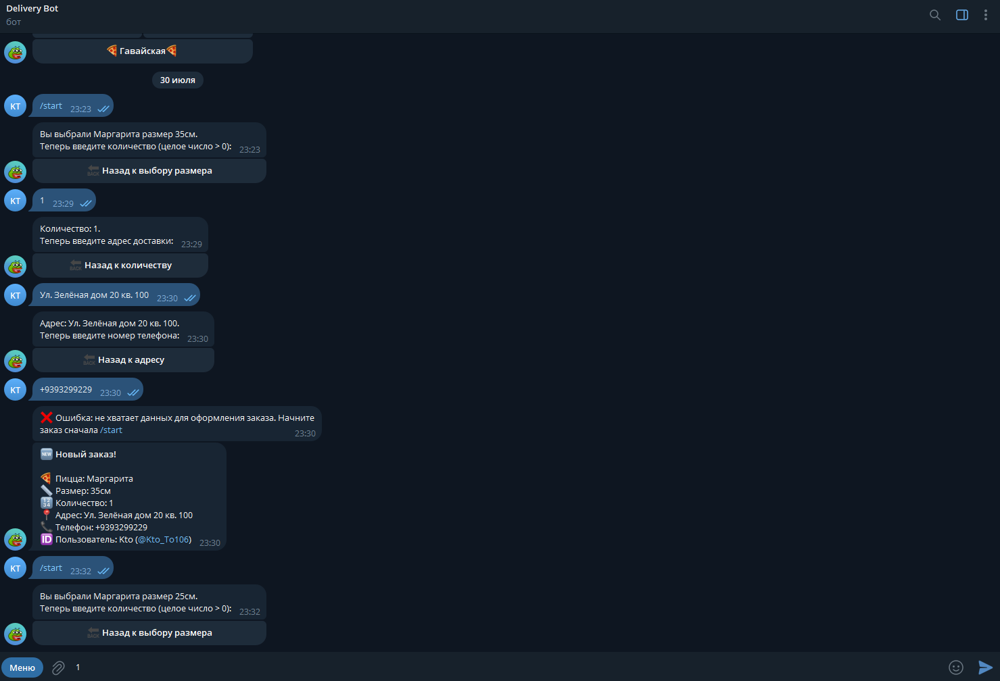
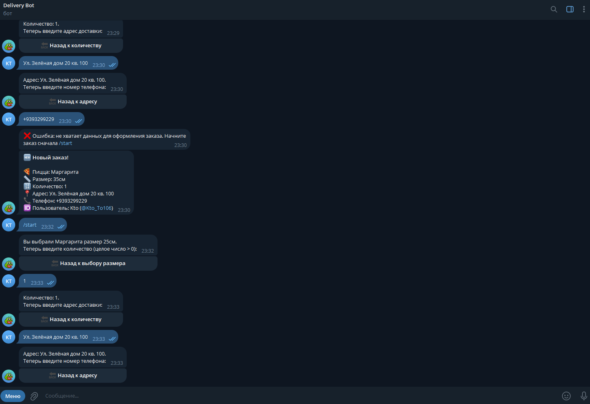

# PizzaOrderBot

A Telegram bot for ordering pizza, featuring user-friendly navigation, input validation, and real-time notifications to the administrator about new orders.

## 🚀 How to Run the Bot

To run this bot on your local machine, follow these steps:

### 1. Download the Code
Clone this repository to your PC or download it as a ZIP archive and extract it to a convenient location.

### 2. Install Dependencies
Open your terminal in the project folder and install the required library for working with Telegram:
```bash
pip install pyTelegramBotAPI
```

If Telegram is unavailable in your region without a proxy, also install the SOCKS5 proxy support library:
```bash
pip install pysocks
```

### 3. Configure Your Data (Placeholders)
Open the `bot_code.py` file using any text editor or IDE (like PyCharm) and replace the demo placeholder values with your real data:

* Instead of `"YOUR_TELEGRAM_TOKEN"`, insert your actual bot token received from `@BotFather`.
* Instead of `"YOUR CHAT ID"`, specify your real Telegram ID (you can find it via `@userinfobot`).
* If you need a proxy, replace `"YOUR PROXY (IF TELEGRAM IS UNAVAILABLE IN YOUR REGION)"` with your proxy address. If a proxy is not required, simply comment out or delete the proxy configuration line.

### 4. Run the Bot
Make sure your Tor client is running on your computer (if you use a proxy) and execute the bot file:
```bash
python bot_code.py
```

Once launched, the bot will automatically restart in case of errors. You will see the message: "Бот запущен. Ожидание обновлений...".

---

### NOTE!
You can test my bot in action by following this link: [@Delivery_23726_bot](https://t.me). Please note that it may be temporarily unavailable, as I do not guarantee 24/7 uptime.

If the bot does not respond, simply run it locally following the instructions above — the code is fully functional.

---

<details>
<summary><b>🇷🇺 Читать описание на русском языке (Click to expand)</b></summary>

# PizzaOrderBot

Телеграм-бот для заказа пиццы с удобной навигацией, проверкой ввода и уведомлением администратора о новом заказе.

## 🚀 Как запустить бота

Чтобы запустить этого бота на своем компьютере, выполните следующие шаги:

### 1. Скачайте код
Склонируйте этот репозиторий к себе на ПК или скачайте его в виде ZIP-архива и распакуйте в удобное место.

### 2. Установите зависимости
Откройте терминал в папке проекта и установите библиотеку для работы с Telegram:
```bash
pip install pyTelegramBotAPI
```

Если в вашем регионе Telegram недоступен без прокси, также установите библиотеку для работы с SOCKS5:
```bash
pip install pysocks
```

### 3. Настройте свои данные (Заглушки)
Откройте файл `bot_code.py` через любой текстовый редактор или среду разработки (PyCharm) и замените демонстрационные данные на свои реальные:

* Вместо `"YOUR_TELEGRAM_TOKEN"` вставьте токен вашего бота, полученный от `@BotFather`.
* Вместо `"YOUR CHAT ID"` укажите ваш реальный Telegram ID (его можно узнать у бота `@userinfobot`).
* Если вам нужен прокси – замените `"YOUR PROXY (IF TELEGRAM IS UNAVAILABLE IN YOUR REGION)"` на адрес вашего прокси. Если прокси не требуется, просто закомментируйте или удалите строку с настройкой прокси.

### 4. Запуск
Убедитесь, что на вашем компьютере запущен Tor-клиент (если вы используете прокси), и запустите файл бота:
```bash
python bot_code.py
```

После запуска бот будет автоматически перезапускаться при сбоях – вы увидите сообщение «Бот запущен. Ожидание обновлений...».

---

### ПРИМЕЧАНИЕ!
Вы можете протестировать моего бота в деле по ссылке [@Delivery_23726_bot](https://t.me), но учтите, что он может быть временно недоступен, так как я не гарантирую его круглосуточную работу.

Если бот не отвечает, просто запустите его локально, следуя инструкции выше – код полностью рабочий.

</details>

## 📸 Процесс оформления заказа в боте

<details>
<summary>🗺 <b>Нажмите, чтобы посмотреть пошаговые скриншоты работы бота</b></summary>
<br>

<table>
  <tr>
    <td align="center"><b>Шаг 1: Главное меню</b><br></td>
    <td align="center"><b>Шаг 2: Выбор размера</b><br></td>
  </tr>
  <tr>
    <td align="center"><b>Шаг 3: Указание количества</b><br></td>
    <td align="center"><b>Шаг 4: Ввод адреса</b><br></td>
  </tr>
  <tr>
    <td align="center" colspan="2"><b>Шаг 5: Подтверждение заказа</b><br></td>
  </tr>
</table>

</details>
