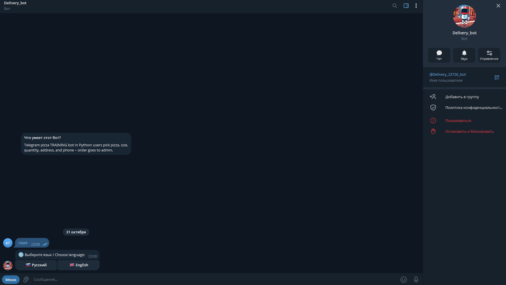
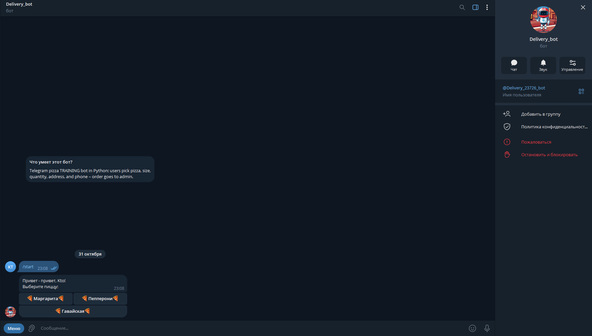
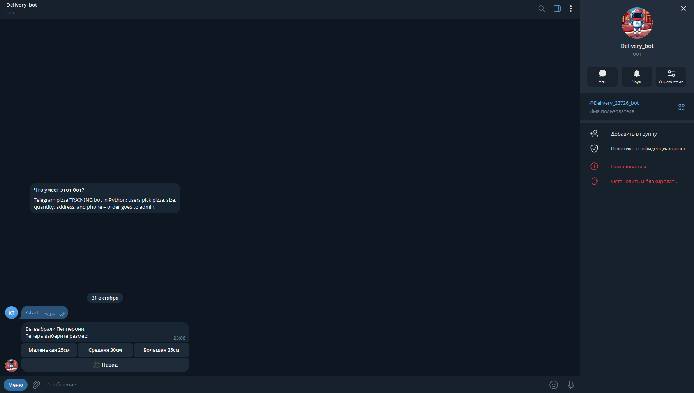

# 🍕 Pizza Ordering Telegram Bot

> 🌐 English version below — Русская версия ниже

Bilingual Telegram bot for ordering pizza with delivery. Supports Russian and English, logs orders to Google Sheets, notifies the administrator, and uses a Cloudflare Worker as a stable proxy for the Telegram API.

## 📋 Table of Contents

- [Demo](#-demo)
- [Features](#-features)
- [Tech Stack](#-tech-stack)
- [Installation](#-installation)
- [Run](#-run)
- [Project Structure](#-project-structure)
- [How It Works](#-how-it-works)
- [License](#-license)

## 🎬 Demo

| Start & Pizza Menu | Language Selection | Size Selection |
|:---:|:---:|:---:|
|  |  |  |

| Quantity Input | Address Input | Phone Input |
|:---:|:---:|:---:|
|  |  |  |

| Order Review | Order Cancellation | Admin Notification |
|:---:|:---:|:---:|
|  |  |  |

## ✨ Features

- **Bilingual interface (RU/EN)** — switch language at any time via `/language`
- **Step-by-step ordering** — pizza → size → quantity → address → phone → confirmation
- **Back navigation** — return to any step to correct data
- **Order cancellation** — cancel the order at any time before confirmation
- **Input validation** — quantity, address, and phone are validated with clear error messages in the selected language
- **Google Sheets logging** — every order is saved with a timestamp
- **Admin notifications** — new orders are sent to the admin in English with a note about the client's language
- **Fault tolerance** — multi-layer retry, local backup, and automatic recovery (see [How It Works](#-how-it-works))
- **Cloudflare Worker as a proxy** — stable access to the Telegram API without a local SOCKS proxy

## 🛠️ Tech Stack

| Component | Purpose |
|-----------|---------|
| Python 3.10+ | Development language |
| pyTelegramBotAPI (telebot) | Telegram Bot API wrapper |
| gspread + oauth2client | Google Sheets integration |
| python-dotenv | Load variables from `.env` |
| Cloudflare Workers | Telegram API proxy |

## 🚀 Installation

### 1. Clone the repository

```bash
git clone <YOUR_REPO_URL>
cd "Train tg bot 3"
```

### 2. Create a virtual environment

```bash
python -m venv venv
```

Windows:
```cmd
venv\Scripts\activate
```

Linux / macOS:
```bash
source venv/bin/activate
```

### 3. Install dependencies

```bash
pip install -r requirements.txt
```

### 4. Configure `.env`

Copy `.env.example` to `.env`:

```cmd
copy .env.example .env
```

Open `.env` and fill in your values following the comments in `.env.example`.

### 5. Place `credentials.json`

Download the Google Service Account key from Google Cloud Console and place it in the project root next to `main.py`.

### 6. Set up Cloudflare Worker

Deploy the Worker (see `docs/cloudflare-worker.md`) or use an existing one. Put the Worker URL in `.env` as `TELEGRAM_API_PROXY_URL`.

## ▶️ Run

```bash
python main.py
```

Expected output:

```
🌐 Using Cloudflare Worker: https://rapid-bar-672d.kto696876.workers.dev
🔗 API URL: https://rapid-bar-672d.kto696876.workers.dev/bot{0}/{1}
✅ Connected to Google Sheets
Bot is running. Waiting for updates...
```

## 📁 Project Structure

```
Train tg bot 3/
├── main.py                  # Main bot code
├── requirements.txt         # Python dependencies
├── .env                     # Secrets (not committed)
├── .env.example             # Variables template
├── .gitignore               # Git exclusions
├── LICENSE                  # MIT License
├── README.md                # This file
├── credentials.json         # Google key (not committed)
├── orders_backup.json       # Created by the bot on failures
└── docs/
    ├── architecture.md      # Detailed architecture
    ├── cloudflare-worker.md # Cloudflare Worker setup
    └── screenshots/         # Screenshots used in this README
```

## ⚙️ How It Works

### Bilingualism

All UI strings are stored in the `TRANSLATIONS` dictionary with `ru` and `en` keys. The function `t(chat_id, key, **kwargs)` returns the string in the user's language (Russian by default). The selected language is stored in `user_language[chat_id]` and switched via 🇷🇺 / 🇬🇧 buttons.

### Bypassing blocks via Cloudflare

Instead of an unstable local SOCKS proxy, the bot uses a Cloudflare Worker as a reverse proxy. In the code this is one line:

```python
telebot.apihelper.API_URL = f"{TELEGRAM_API_PROXY_URL}/bot{{0}}/{{1}}"
```

All requests to `api.telegram.org` go through `https://<worker>.workers.dev`. If the Worker's URL ever changes, only one line in the code and one variable in `.env` need to be updated — nothing else.

### Fault tolerance

The bot is designed to keep accepting orders even when external services fail. Every failure is handled in layers:

**1. Retries with delays (Google Sheets)**

If Google Sheets rejects a write (network error, quota, temporary outage), the bot retries **3 times with a 5-second pause** between attempts. This covers most short-lived issues without bothering the user.

**2. Local backup file (`orders_backup.json`)**

If all retries fail, the order is not lost — it is saved to a local JSON file. The file survives bot restarts and accumulates undelivered orders until Google Sheets becomes available again.

**3. Automatic retry on startup**

Every time the bot starts, `retry_failed_orders()` reads the backup file and tries to resend every stored order — **2 attempts per order with a 3-second delay**. Successful orders are removed from the file, failed ones stay for the next startup. When the file becomes empty, it is deleted automatically.

**4. Independent failure tracking**

Sending to the admin and writing to Google Sheets are handled **independently**. The user always receives their order confirmation, but the message is adjusted based on what actually happened:

- Both OK → `✅ Thank you! Your order has been accepted.`
- Admin notification failed → `…However, there was a problem notifying the administrator. We will contact you soon.`
- Sheets write failed → `…Your order has been saved, but there may be a slight delay in processing. The administrator will contact you.`

This way the user is never left without feedback, and the message honestly reflects the real state of the order.

**5. Auto-restart on crash**

The main loop is wrapped in `try/except` with a 5-second delay before restart. Any unhandled exception in `bot.polling()` does not kill the process — the bot simply reconnects.

**6. Startup resilience**

If Google Sheets cannot be initialized at startup (network, credentials, quota), the bot does **not** crash — it continues to run with `sheet = None`. In this mode, every new order goes straight to the backup file, and admin notifications still work. When the bot restarts and the connection is restored, all pending orders are flushed to Sheets.

## 📄 License

MIT — see [LICENSE](LICENSE).

---

# 🍕 Pizza Ordering Telegram Bot

Двуязычный Telegram-бот для заказа пиццы с доставкой. Поддерживает русский и английский языки, сохраняет заказы в Google Sheets, уведомляет администратора и использует Cloudflare Worker как стабильный прокси для Telegram API.

## 📋 Содержание

- [Демо](#-демо)
- [Возможности](#-возможности)
- [Технологии](#-технологии)
- [Установка](#-установка)
- [Запуск](#-запуск)
- [Структура проекта](#-структура-проекта)
- [Как это работает](#-как-это-работает)
- [Лицензия](#-лицензия)

## 🎬 Демо

| Главное меню и выбор пиццы | Выбор языка | Выбор размера |
|:---:|:---:|:---:|
|  |  |  |

| Ввод количества | Ввод адреса | Ввод телефона |
|:---:|:---:|:---:|
|  |  |  |

| Проверка заказа | Отмена заказа | Уведомление админу |
|:---:|:---:|:---:|
|  |  |  |

## ✨ Возможности

- **Двуязычный интерфейс (RU/EN)** — переключение языка в любой момент через `/language`
- **Пошаговый заказ** — пицца → размер → количество → адрес → телефон → подтверждение
- **Навигация «назад»** — можно вернуться на любой шаг и исправить данные
- **Отмена заказа** — можно отменить оформление на любом этапе до подтверждения
- **Валидация ввода** — количество, адрес и телефон проверяются с понятными ошибками на выбранном языке
- **Запись в Google Sheets** — все заказы сохраняются в таблицу с меткой времени
- **Уведомления администратору** — новый заказ приходит в Telegram на английском с пометкой языка клиента
- **Отказоустойчивость** — многослойная система повторов, локальный резерв и автовосстановление (см. [Как это работает](#-как-это-работает))
- **Cloudflare Worker как прокси** — стабильный доступ к Telegram API без локального SOCKS-прокси

## 🛠️ Технологии

| Компонент | Назначение |
|-----------|-----------|
| Python 3.10+ | Язык разработки |
| pyTelegramBotAPI (telebot) | Работа с Telegram Bot API |
| gspread + oauth2client | Запись заказов в Google Sheets |
| python-dotenv | Загрузка переменных из `.env` |
| Cloudflare Workers | Прокси для Telegram API |

## 🚀 Установка

### 1. Клонировать репозиторий

```bash
git clone <URL_вашего_репозитория>
cd "Train tg bot 3"
```

### 2. Создать виртуальное окружение

```bash
python -m venv venv
```

Windows:
```cmd
venv\Scripts\activate
```

Linux / macOS:
```bash
source venv/bin/activate
```

### 3. Установить зависимости

```bash
pip install -r requirements.txt
```

### 4. Настроить `.env`

Скопируйте `.env.example` в `.env`:

```cmd
copy .env.example .env
```

Откройте `.env` и заполните значения по комментариям в `.env.example`.

### 5. Положить `credentials.json`

Скачайте ключ Google Service Account из Google Cloud Console и положите его в корень проекта рядом с `main.py`.

### 6. Настроить Cloudflare Worker

Разверните Worker по инструкции `docs/cloudflare-worker.md` или используйте существующий. URL воркера укажите в `.env` как `TELEGRAM_API_PROXY_URL`.

## ▶️ Запуск

```bash
python main.py
```

Ожидаемый вывод:

```
🌐 Используем Cloudflare Worker: https://rapid-bar-672d.kto696876.workers.dev
🔗 API URL: https://rapid-bar-672d.kto696876.workers.dev/bot{0}/{1}
✅ Подключение к Google Sheets успешно
Бот запущен. Ожидание обновлений...
```

## 📁 Структура проекта

```
Train tg bot 3/
├── main.py                  # Основной код бота
├── requirements.txt         # Зависимости Python
├── .env                     # Секреты (не коммитится)
├── .env.example             # Шаблон переменных
├── .gitignore               # Исключения для Git
├── LICENSE                  # MIT License
├── README.md                # Этот файл
├── credentials.json         # Ключ Google (не коммитится)
├── orders_backup.json       # Создаётся ботом при сбоях
└── docs/
    ├── architecture.md      # Подробное описание архитектуры
    ├── cloudflare-worker.md # Настройка Cloudflare Worker
    └── screenshots/         # Скриншоты для README
```

## ⚙️ Как это работает

### Двуязычность

Все строки интерфейса хранятся в словаре `TRANSLATIONS` с ключами `ru` и `en`. Функция `t(chat_id, key, **kwargs)` возвращает строку на языке пользователя (по умолчанию — русский). Выбранный язык хранится в `user_language[chat_id]` и меняется кнопками 🇷🇺 / 🇬🇧.

### Обход блокировок через Cloudflare

Вместо нестабильного локального SOCKS-прокси бот использует Cloudflare Worker как обратный прокси. В коде это одна строка:

```python
telebot.apihelper.API_URL = f"{TELEGRAM_API_PROXY_URL}/bot{{0}}/{{1}}"
```

Все запросы к `api.telegram.org` идут через `https://<worker>.workers.dev`. Если URL воркера когда-либо изменится — достаточно поправить одну строку в коде и одну переменную в `.env`, ничего больше.

### Отказоустойчивость

Бот спроектирован так, чтобы принимать заказы даже при сбоях внешних сервисов. Каждый сбой обрабатывается в несколько слоёв:

**1. Повторные попытки с паузами (Google Sheets)**

Если Google Sheets отклоняет запись (сетевая ошибка, квота, временная недоступность), бот повторяет **3 раза с паузой 5 секунд**. Это покрывает большинство коротких сбоев и не беспокоит пользователя.

**2. Локальный резервный файл (`orders_backup.json`)**

Если все попытки провалились, заказ не теряется — он сохраняется в локальный JSON-файл. Файл переживает перезапуск бота и накапливает неотправленные заказы, пока Google Sheets снова не станет доступен.

**3. Автоматическая отправка при старте**

Каждый раз при запуске `retry_failed_orders()` читает резервный файл и пытается отправить все сохранённые заказы — **2 попытки на заказ с паузой 3 секунды**. Успешные заказы удаляются из файла, неуспешные остаются до следующего запуска. Когда файл становится пустым, он удаляется автоматически.

**4. Раздельный учёт сбоев**

Уведомление админа и запись в Google Sheets обрабатываются **независимо**. Пользователь всегда получает подтверждение заказа, но текст сообщения адаптируется под реальную ситуацию:

- Всё успешно → `✅ Спасибо! Ваш заказ принят.`
- Уведомление админу не ушло → `…Но возникла проблема с уведомлением администратора. Мы скоро свяжемся с вами.`
- Запись в Sheets не удалась → `…Ваш заказ сохранён, но возможна небольшая задержка в обработке. Администратор свяжется с вами.`

Так пользователь никогда не остаётся без ответа, а сообщение честно отражает состояние заказа.

**5. Автоперезапуск при падении**

Основной цикл обёрнут в `try/except` с паузой 5 секунд перед перезапуском. Любое необработанное исключение в `bot.polling()` не убивает процесс — бот просто переподключается.

**6. Устойчивость на старте**

Если Google Sheets не удаётся инициализировать при запуске (сеть, ключ, квота), бот **не падает** — он продолжает работать с `sheet = None`. В этом режиме каждый новый заказ идёт сразу в резервный файл, а уведомления админу продолжают работать. При следующем запуске, когда соединение восстановится, все накопленные заказы уйдут в Sheets.

## 📄 Лицензия

MIT — см. [LICENSE](LICENSE).
